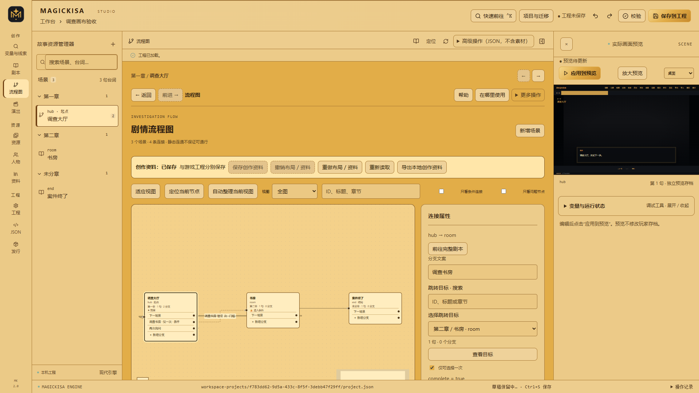
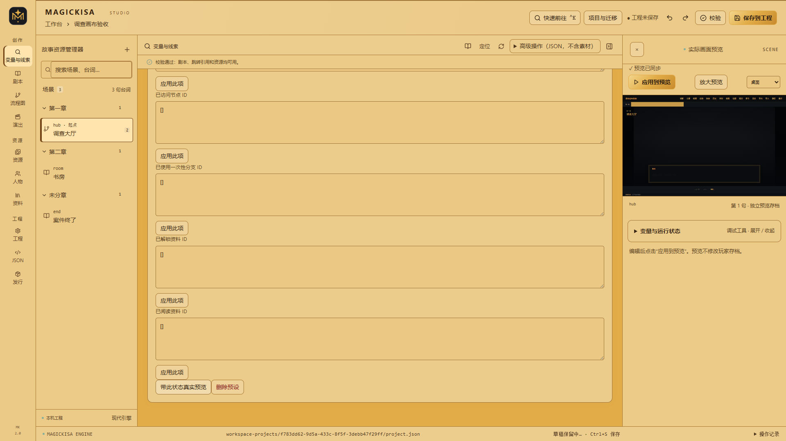

# MAGICKISA

### 在浏览器中呈现故事，用 Studio、代码或 AI Agent 创作游戏。

[](https://github.com/Kisara-Lab/Magickisa-AVG-WEBGAME-ENGINE/actions/workflows/ci.yml)
[](LICENSE)
[](CHANGELOG.md)

**MAGICKISA 是一套开源的网页 AVG／视觉小说引擎，附带可视化编辑器 MAGICKISA Studio 和面向终端、AI Agent 的 CLI。** 从连续台词、人物立绘到复杂分支、线索条件和 OP／ED，可以在同一工程中创作、调试并构建为网页游戏。

**[▶ 在线体验实际作品](https://ilmarin.kisara.info/) · [快速开始](#快速开始) · [Studio 创作](#用-studio-制作游戏) · [AI Agent 接入](#让-ai-agent-接入你的剧本) · [文档导航](#文档导航)**

## 先看看能做出什么

### 成果演示：《伊尔玛林的黄昏》

**[点击进入游戏 → https://ilmarin.kisara.info/](https://ilmarin.kisara.info/)**

这是一部使用 MAGICKISA 制作的实际作品。想先了解引擎呈现出的游戏体验，可以直接打开游玩；想了解如何制作，请看下面的 Studio 界面与上手步骤。

> 演示站点独立维护，不保证与 `main` 开发版同步。游戏剧情、图片、音乐等内容不包含在本仓库中，也不因引擎使用 MIT 许可证而获得 MIT 授权。本仓库提供引擎与编辑器，暂不附带 Demo 工程或游戏素材。

### 创作界面：MAGICKISA Studio



_在图上组织场景与跳转，在侧栏精确编辑分支、条件和效果。也可以通过关系列表与表单操作，无须拖线。_

## 为什么选择 MAGICKISA

| 你想完成的事                   | MAGICKISA 提供的能力                                                                   |
| ------------------------------ | -------------------------------------------------------------------------------------- |
| 把剧本做成可玩的视觉小说       | 场景与连续台词、人物与表情、背景与立绘图层、音轨、历史、自动播放、已读快进与存读档     |
| 制作长篇视觉小说与 GALGAME     | ADV／NVL、作品主题、逐句配音、多轨舞台与关键帧、音量包络及可复用演出预设               |
| 减少重复劳动并验证改稿         | 范围替换、多选台词、变量协调重命名、预览录制路线测试和实际条件覆盖                     |
| 编排复杂分支，不迷失在跳转里   | 可编辑流程画布、独立分支连线、自环与地点回访、章节／邻域筛选、自动布局、入边与出边追踪 |
| 制作单人侦探调查与非线性叙事   | 用资料表达线索，组合变量、访问记录、资料解锁／阅读和列表条件，配置一次性选择与多结局   |
| 调试“为什么这个选项不能选”     | 变量与线索工作台、具名测试状态、从指定场景真实预览、分支条件与目标门槛解释             |
| 让玩家舒适地阅读与保留进度     | 紧凑菜单、字号与逐字设置、自动／已读快进、12 个手动槽、恢复副本与多标签页写入保护      |
| 让 Codex 等 Agent 帮忙落地剧本 | CLI、JSON 批量事务、工程上下文、差异方案、增量同步和人工修改冲突保护                   |
| 为作品编排开场与片尾           | 引擎标识动画、献词、OP 镜头与定时字幕、双语 ED 与鸣谢编辑                              |
| 换电脑继续开发，再发布给玩家   | 工程与全部素材整体打包、独立导入、备份与版本冲突检查，构建可部署的静态网页             |

**可视化与代码编辑可以交替使用。** Studio 保留完整 JSON、递归条件、效果、图层、精确时间和运行变量调试；CLI 与 Studio 共用工程规则、revision 检查和写锁。

适合视觉小说、分支互动故事、单人调查游戏，以及剧本杀式文字叙事。当前不提供多人联网、主持人系统、玩家举证界面或专用任务系统。

## 快速开始

需要 **[Node.js 22+](https://nodejs.org/)（包含 npm）**、现代浏览器和可写目录。支持 Windows、macOS、Linux；首次安装依赖需要联网。

### 方式一：获取源码并启动

```sh
git clone https://github.com/Kisara-Lab/Magickisa-AVG-WEBGAME-ENGINE.git
cd Magickisa-AVG-WEBGAME-ENGINE
npm ci
npm run dev
```

启动后会打开工程管理页，通常为 **http://127.0.0.1:5173/engine.html**。以终端显示的实际地址为准。

1. 输入作品名称，选择“创建并打开”；也可以导入已有 `.magickisa.zip` 工程包。
2. 编辑起始场景的台词，添加场景与分支。
3. 点击预览或按 `Ctrl+Enter`，在真实运行时中检查效果。

新工程只包含满足格式要求的最小内容，剧情与媒体由你添加。使用期间请保持终端运行，按 `Ctrl+C` 停止服务；服务仅监听 `127.0.0.1`。

### 方式二：使用仓库中的启动入口

获取并解压完整源码后，也可以使用以下脚本，由启动器检查环境、安装依赖并打开 Studio：

| 系统    | 启动方式                                                      |
| ------- | ------------------------------------------------------------- |
| Windows | 双击 `Start-Studio.cmd`                                       |
| macOS   | 双击 `Start-Studio.command`，或执行 `sh Start-Studio.command` |
| Linux   | 执行 `sh Start-Studio.sh`                                     |

这些入口仍需要预装 Node.js。后续启动复用已安装依赖，锁文件或环境变化时重新安装。同一目录只运行一个 Studio。详见 [启动与故障排查](START-HERE.md)。

> **开发版本：** 本分支为 **2.0.0-dev.5**，仅开发现代版，尚未发布 V2 正式 Release。工程与存档格式升级为 3，工程包格式为 2；旧开发版文件请先保留备份，不提供自动转换。需要旧兼容档，请使用冻结的 [v1.0legacy Release](https://github.com/Kisara-Lab/Magickisa-AVG-WEBGAME-ENGINE/releases/tag/v1.0legacy)。详见 [破坏性变更](BREAKING-CHANGES.md)与[本轮实施状态](docs/CREATOR-UPGRADE.md)。

**使用 v1.0legacy？请阅读 [Legacy 专用手册](docs/legacy/README.md)**，涵盖下载安装、双模式创作、剧情逻辑、献词／OP／ED、工程迁移、备份恢复与网页发行。

## 用 Studio 制作游戏

### 1. 写剧本，连接场景

在剧本页连续编辑台词，设置人物、表情、背景与图层。在流程页拖线创建“下一场景”或选择分支，也可以用侧栏表单操作。目标支持按 ID、标题和章节搜索。

剧情较大时，切换到章节或一至两层邻域，查看入边、出边与跨范围连接。自动整理是显式操作；普通文字修改不会重排手动位置。跳转、条件和效果保留稳定 ID，方便引用追踪与 Agent 协作。

### 2. 配置线索、变量与门槛

在资料页建立线索，使用解锁、阅读和变量效果推进调查；用“全部／任一／取反”组合条件，表达询问、地点回访、调查进度与结局门槛。“变量与线索”页汇总读写与使用位置，可添加用途说明。

### 3. 带着测试状态预览

建立具名预设，设置变量、访问记录、已用分支与资料状态，从指定场景启动真实预览。连接解释可以说明分支条件、一次性限制及效果执行后的目标门槛。



测试预设不写入真实玩家存档。静态连接分析和单状态解释不能证明所有路线都可通行，仍需实际游玩检查创作意图。完整步骤见 [调查与复杂流程手册](docs/INVESTIGATION.md)。

### 4. 添加素材与演出

通过素材选择器回填背景、立绘和音频，在演出页编排献词、OP 与 ED。支持字幕时间轴、镜头排序与精确数字输入；不配置特殊演出也可以制作游戏。

单素材流式上传上限为 **512 MiB**，显示进度并可取消。素材检查支持引用保护删除、原位替换和历史恢复。也可在当前项目 `public/` 中放置资源，例如 `public/audio/theme.mp3` 对应 `/audio/theme.mp3`，不要填写本机绝对路径。Live2D 提供外部适配器接入能力，Cubism SDK、模型及其许可需自行准备。

通用演出提供背景、人物、镜头、文字、BGM、音效、配音及视频轨道；时间轴和精确表单共用编辑入口。轨道可锁定、排序、独奏预览，支持关键帧与作者预设。完整操作见[创作生产工作流](docs/CREATOR-WORKFLOW.md)。

### 常用快捷键与保存规则

| 快捷键       | 操作                                   |
| ------------ | -------------------------------------- |
| `Ctrl+K`     | 搜索操作、场景、台词、人物、资料与素材 |
| `Ctrl+S`     | 保存工程                               |
| `Ctrl+Enter` | 更新真实预览                           |
| `Esc`        | 关闭浮层                               |

浏览器草稿、磁盘工程和预览有各自状态：**“草稿已保留”不等于工程已保存**。输入时不会自动重启剧情；修改后手动更新预览。有未应用 JSON 时，先处理输入，再保存、导出或构建。外部修改触发 409 冲突，不会静默覆盖。

节点坐标、变量注释与测试预设另存于 `authoring/studio.json`，有独立保存状态，不进入游戏发行产物。

## 让 AI Agent 接入你的剧本

可以把 UTF-8 TXT、Markdown、JSON 剧本和逻辑说明交给 Codex 等外部 Agent。由 Agent 理解内容、读取工程上下文并整理结构稿，再用 MAGICKISA 检查差异与应用。

**提供原稿 → 读取上下文 → 整理多文件结构稿 → 检查方案 → 应用 → 校验与真实预览。**

安装依赖后，CLI 无须启动 Studio 服务即可工作：

```sh
node scripts/magickisa.mjs project create --name "我的调查故事" --json
```

将下面的 `WORKSPACE_ID` 替换为创建结果中的 `workspaceId`：

```sh
node scripts/magickisa.mjs agent init --workspace WORKSPACE_ID --json
node scripts/magickisa.mjs agent context --workspace WORKSPACE_ID --limit 20 --json
node scripts/magickisa.mjs source add --workspace WORKSPACE_ID --id chapter-1 --file "我的剧本.txt" --json
```

让 Agent 阅读 [Agent 开发指南](docs/AGENT-GUIDE.md)，参考生成的 `authoring/AGENTS.md` 和模板，整理 `authoring/manifest.json` 与模块文件。**登记原稿不会自动生成游戏**；结构稿准备好后执行：

```sh
node scripts/magickisa.mjs sync plan --workspace WORKSPACE_ID --out plan.json --json
node scripts/magickisa.mjs sync apply --workspace WORKSPACE_ID --file plan.json --dry-run --json
node scripts/magickisa.mjs sync apply --workspace WORKSPACE_ID --file plan.json --json
node scripts/magickisa.mjs validate --workspace WORKSPACE_ID --json
node scripts/magickisa.mjs graph --workspace WORKSPACE_ID --json
node scripts/magickisa.mjs build --workspace WORKSPACE_ID --json
```

方案会展示差异、诊断和冲突；首次接管已有内容或同字段冲突需要显式选择。再次改稿采用三方比较保护 Studio 人工编辑，省略内容不会自动删除。输出文件需使用新路径，避免覆盖旧方案。

CLI 不调用模型、不执行用户提供的 JS／TS，也不替 Agent 理解自然语言。完整多文件示例见 [剧本接入与增量同步](docs/AUTHORING.md)。

### 更喜欢直接写代码？

可以直接用 `scene`、`line`、`choice`、`condition`、`effect`、`entity`、`media` 等命令编辑，也可以准备 JSON 事务，一次提交跨场景修改：

```sh
node scripts/magickisa.mjs help --json
node scripts/magickisa.mjs schema transaction --json
# 按 CLI 手册准备 story.json 后：
node scripts/magickisa.mjs edit --workspace WORKSPACE_ID --file story.json --dry-run --json
node scripts/magickisa.mjs edit --workspace WORKSPACE_ID --file story.json --json
```

支持文件／stdin 输入、稳定 ID、批量前向引用、revision 保护与整批失败不写入。CLI 编辑磁盘工程，不读取浏览器未保存草稿。命令清单与可执行事务示例见 [CLI 手册](docs/CLI.md)。

## 导出工程与发布游戏

这两种输出用途不同：

| 输出                            | 用途                         | 如何获取                                                          |
| ------------------------------- | ---------------------------- | ----------------------------------------------------------------- |
| **整体工程包** `.magickisa.zip` | 换电脑、交接、归档后继续编辑 | 工程页执行“检查 → 查看摘要 → 导出”，或使用 CLI `package export`   |
| **游戏发行产物** `dist/`        | 部署网站，供玩家游玩         | Studio 执行“检查内容 → 保存工程 → 构建发行包”，或使用 CLI `build` |

**工程包**携带工程、全部素材（包括未使用素材）、结构稿、同步基线与 Studio 创作资料。默认不携带原始附件，CLI 加 `--include-sources` 才加入；也不包含引擎、依赖、浏览器草稿、玩家存档或历史备份。导入始终创建独立工程，重复导入不会覆盖原项目。

工程包使用格式 2，记录工程格式及最低引擎版本，按文件校验 SHA256；ZIP 上限 2 GiB、解压总量 8 GiB、文件数 50,000。外部资源保留链接，不自动下载。格式 1 工程包请使用原版本 Studio，本开发版不自动转换。

**游戏构建**也可以从命令行执行：

```sh
node scripts/magickisa.mjs build --workspace WORKSPACE_ID --json
```

独立工程输出到 `workspace-projects/<workspaceId>/dist/`。将该目录内容部署到静态网站根目录，通过 HTTP(S) 游玩；子路径部署需要额外路径配置，外链素材仍依赖对应服务。**玩家无需安装 Node.js 或 Studio。**

工程保存在 `workspace-projects/`，不会提交到引擎仓库。保存前会备份旧工程，但历史备份不代替含全部素材的整体工程包；升级引擎前建议先导出归档。

## 文档导航

| 我想了解……                                     | 阅读                                                         |
| ---------------------------------------------- | ------------------------------------------------------------ |
| 玩家端阅读设置、资料查阅、存读档与多标签页保护 | [玩家使用指南](docs/PLAYER.md)                               |
| v1.0legacy 的完整使用方法                      | [Legacy 专用手册](docs/legacy/README.md)                     |
| 启动脚本、环境要求、安装与连接故障             | [启动说明](START-HERE.md)                                    |
| 复杂跳转、资料条件、测试预设与画布操作         | [调查工作台手册](docs/INVESTIGATION.md)                      |
| 全部命令、JSON 事务、退出码与工程包操作        | [CLI 手册](docs/CLI.md)                                      |
| 怎样让 Codex 等 Agent 安全参与开发             | [Agent 开发指南](docs/AGENT-GUIDE.md)                        |
| 多文件剧本接入、改稿同步与冲突处理             | [创作接入手册](docs/AUTHORING.md)                            |
| 版本变化与旧工程兼容边界                       | [变更记录](CHANGELOG.md) · [破坏性变更](BREAKING-CHANGES.md) |
| 修改引擎、运行测试与提交 PR                    | [贡献说明](CONTRIBUTING.md)                                  |

## 引擎开发与能力边界

引擎采用 **React + TypeScript**，流程画布使用 React Flow 与 Dagre。运行时公开入口为 [src/engine/index.ts](src/engine/index.ts)，条件与效果可注册扩展处理器。

```text
src/engine/         运行时、状态、条件效果、存档与校验
src/game/           通用玩家界面
src/studio/         可视化编辑器与品牌样式
scripts/            CLI、本地服务、Agent 同步、工程包与构建
tests/              使用生成数据的通用测试
workspace-projects/ 本地工程、素材与输出（Git 忽略）
```

安装依赖后，可按顺序运行：

```sh
npm run typecheck
npm test
npm run test:cli
npm run test:authoring
npx playwright install chromium
npm run test:player
npm run test:studio
npm run notices:check
npm run build:studio
```

涉及工程写入的验收请顺序执行。Linux 浏览器依赖安装及完整开发约定见 [贡献说明](CONTRIBUTING.md)。CI 在 Windows、macOS、Linux 执行通用、CLI、Agent 和启动器验收，并在 Ubuntu 执行类型检查、浏览器验收与 Studio 构建。

使用前请了解这些边界：

- 当前 V2 是开发版；兼容档停留在 `v1.0legacy`，不提供转换工具。
- 当前工程使用 `schemaVersion: 3`，玩家存档按稳定台词 ID 与阶段定位。旧开发版工程、存档与格式 1 工程包需保留原版本读取，不自动迁移。
- 没有内置模型调用、MCP、专用剧本语言或无界面剧情模拟；剧情效果需要真实预览验收。
- 当前不提供 npm 发行包或托管 Studio 服务；静态 `dist-studio/` 不能替代完整本地服务。
- 工程备份管理改进见 [#6](https://github.com/Kisara-Lab/Magickisa-AVG-WEBGAME-ENGINE/issues/6)。玩家端现有作品级多标签页写入保护，安全保存需要支持 Web Locks 的浏览器与 HTTPS／本机环境；其他环境可临时游玩并导出进度。

## 许可与参与

**引擎、Studio 与仓库自有品牌 SVG 使用 [MIT License](LICENSE)，允许商业使用。** 请保留版权与许可声明；第三方依赖、SDK、游戏剧本和媒体分别遵守各自授权。第三方声明见 [THIRD_PARTY_NOTICES.md](THIRD_PARTY_NOTICES.md)。

由 **[Kisara-Lab](https://github.com/Kisara-Lab)** 维护。欢迎 [提交 Issue](https://github.com/Kisara-Lab/Magickisa-AVG-WEBGAME-ENGINE/issues) 或通过 PR 改进引擎；报告问题时请附系统、Node.js 版本与复现步骤，并移除凭据和私人游戏内容。
