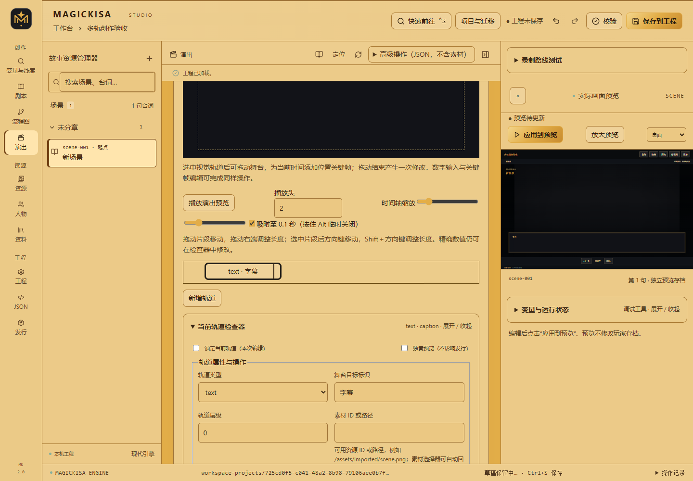
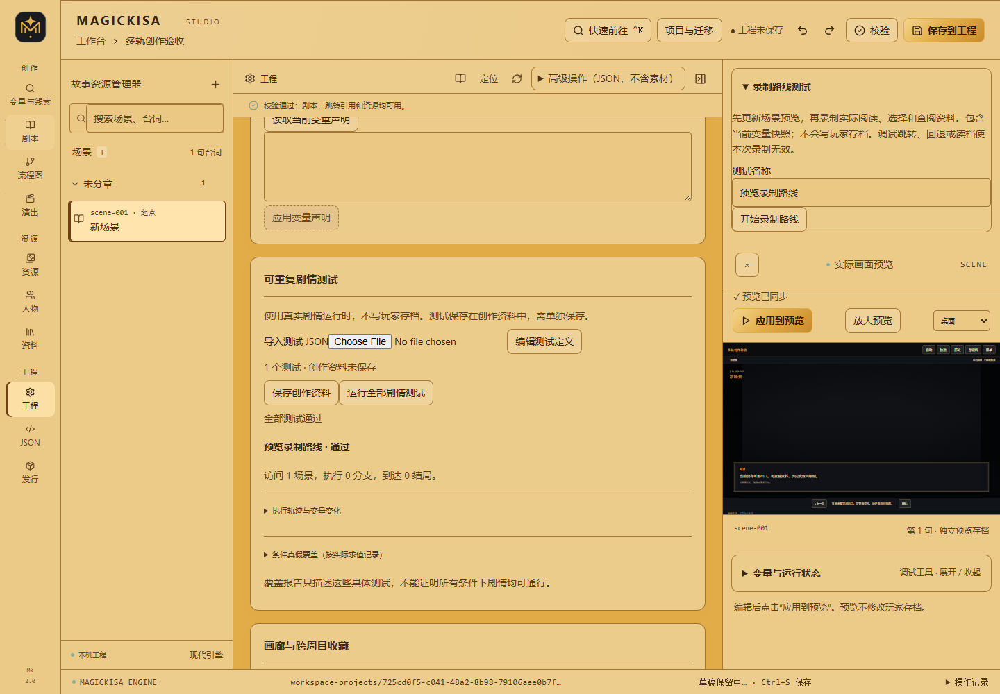
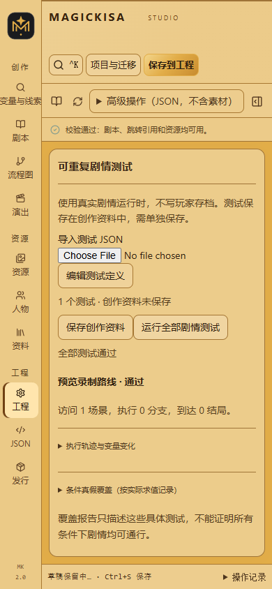

# 创作工作流（dev.5 实施中）

本文描述当前功能分支已实现的操作，不代表本轮整体升级已发布。完整交付进度见 [实施记录](CREATOR-UPGRADE.md)。请先备份工程；此开发版使用工程／存档格式 3、工程包格式 2、Studio 创作资料格式 2，不提供旧开发版转换器。

## 从空白作品开始

演出数值输入和等待点支持编辑草稿：非法值留在输入框并提示“尚未应用”，不会覆盖工程中的原值。等待点使用英文逗号分隔，须严格递增、非负且小于演出长度；完整填写后应用。预览音频权限被浏览器阻止时，按提示点击预览画面再重试；媒体加载失败仍显示错误，状态区可同时保留最近操作结果。

1. 在工程管理创建空白工程。项目只包含满足格式要求的最小结构，没有示例剧情或素材。
2. 工程页的“作品概览”提供创作清单；设置标题、起点和“作品阅读与主题”。
3. 视觉小说可使用 ADV 底部对话；长段叙事可选择 NVL 全屏文字。场景可覆盖工程布局，台词可设置分页。
4. 在剧本页写作，在流程图配置分支；单人调查使用已有资料、条件与变量，不需要切换另一套工程模式。
5. 更新真实预览检查作品。表单输入不会自动重启剧情；最后分别保存工程和创作资料。

玩家自定义字号等阅读设置优先于作者默认主题。主题改变后应检查桌面与手机的实际显示效果。

## 连续写作与整批修改

剧本页的“批量写作与替换”支持当前场景、当前章节和全工程范围的字面替换。先检查差异，再选择需要应用的行；正文替换不会改写素材路径。旧差异中的正文已变化时拒绝应用，需要重新检查。

可读取 UTF-8 TXT／Markdown，把非空行预览后追加为台词。这是正文导入，不会猜测人物、条件或跳转；复杂原稿请使用 Agent 结构稿工作流。

“多选台词操作”支持搜索、分页选择、复制、上下移动、跨场景移动和删除。移动保留稳定 ID、条件、图层、输入、配音和演出配置；复制生成新 ID。整批操作一次撤销。删除台词会影响引用该 ID 的路线测试或来源映射，必须复核。

## 配音与多轨演出

台词高级属性可指定配音资源和通用演出。场景可设置进入／离开演出。演出页的“多轨演出与舞台”管理独立的序列：

- 轨道类型：背景、人物、镜头、文字、BGM、音效、配音和视频。
- 在时间轴拖动片段移动，拖动右端修改长度；默认吸附 0.1 秒，Alt 临时取消吸附。
- 选中片段后，左右键移动，Shift＋左右键调整长度；Esc 取消尚未释放的拖动。
- 检查器提供开始时间、长度、素材偏移、音量、循环和禁用；缩短片段不能悄悄删掉范围外的关键帧。
- 可视关键帧编辑提供位置、缩放、透明度、旋转、震动和缓动，仍保留完整关键帧 JSON。
- 音量包络范围为 0–1，与轨道音量及玩家音量相乘。两条使用不同舞台目标标识的音轨可以重叠，一条从 1 降到 0、另一条从 0 升到 1，实现交叉淡化。
- 锁定轨道后，时间轴、舞台与属性编辑均禁止改动；独奏只影响 Studio 预览，不修改发行配置。两者仅在本次编辑生效。上移／下移调整轨道顺序，开始时间保持不变。
- “复用演出预设”可以复制、导出 JSON 或检查导入。复制生成新的演出和轨道 ID；预设不携带素材，不自动绑定名称相似的人物。导入摘要列出媒体路径和人物 ID，应用前需核对目标工程中的资源。
- 选中视觉轨道后在舞台拖动，为播放头位置创建位置关键帧；释放时提交一次修改。
- 等待点暂停演出，玩家点击继续。允许跳过的序列可直接到达终态；退出演出后保留终态画面，进入下一场景清除。

时间轴只控制画面和媒体，不执行 JS／TS、变量效果或剧情跳转。剧情逻辑仍放在场景和分支中。台词配音与同句演出语音轨道不能重复占用。演出期间普通场景 BGM 和台词配音暂停。



“演出引用与删除”列出当前工程使用位置；有引用时先修改场景／台词绑定。删除演出保留素材文件，可用工程撤销恢复。OP／ED 采用相同有限时钟，献词保留手动翻页，不新增自动页时长。

Studio 的舞台预览使用当前工作区素材。图片、音频和视频选择器可以回填路径；浏览器不支持某种编码时会提示加载失败。视频和音频格式的扩展名不代表所有浏览器均支持其内部编码。

## 资料与路线验收

调查故事仍使用资料解锁／已读条件、列表包含、变量与组合条件表达逻辑。工程页“可重复剧情测试”可导入、编辑和运行声明式测试，结果显示执行轨迹、变量变化和失败位置。

测试保存在独立创作资料中，需点击“保存创作资料”。修改工程或测试定义会使原报告失效。测试起始状态非法时，该测试报告步骤 0 失败，其他测试仍继续执行。

终端执行：

```sh
node scripts/magickisa.mjs test list --workspace WORKSPACE_ID --json
node scripts/magickisa.mjs test run --workspace WORKSPACE_ID --file routes.json --out report.json --json
node scripts/magickisa.mjs schema tests --json
```

测试使用真实剧情运行时，且不写玩家存档。覆盖报告只代表这些具体路线，不能证明全部条件下均可通行。声音、图像、视频及布局仍需真实浏览器验收。

真实预览旁的“录制路线测试”可从当前内存状态录制操作，停止后检查 JSON，再加入创作测试。录制包含推进、输入、分支选择、资料阅读和演出完成；跳转调试、回退、重置或读档会使本次记录失效，需要重新录制。初始状态快照避免重放时重复执行进入效果，玩家笔记与历史不作为录制输入。

条件覆盖只记录实际求值结果。组合条件短路时，没有求值的子条件仍为未覆盖，不把整棵条件树当作已测试。修改工程或测试后，应重新运行。



<details>
<summary>查看手机测试面板</summary>



</details>

## 变量、画廊与扩展

工程页支持声明变量类型与初始值，列表和对象保留 JSON 编辑；变量声明与变量用途注释分开保存。调查逻辑仍由条件与效果完成。

“协调重命名变量”先展示明确引用位置，确认后一次备份并协调保存工程和创作资料。覆盖声明、条件、效果、玩家输入、台词双花括号插值、测试预设、录制初始状态及断言；目标名已有引用时拒绝合并。原始剧本、Agent 结构稿与同步基线不自动改写，后续同步需检查差异。玩家旧存档也不改写，已发行作品请评估内容版本。恢复旧名称可使用同一操作或备份恢复。

```sh
node scripts/magickisa.mjs variable rename-plan --workspace WORKSPACE_ID --from clue --to evidence --out rename-plan.json --json
node scripts/magickisa.mjs variable rename --workspace WORKSPACE_ID --file rename-plan.json --json
```

画廊条目使用明确的图片与解锁条件。玩家通过菜单查看“画廊与结局”，未解锁条目隐藏名称与图片；收集记录按作品保留，重新开始故事不清空。Studio 内嵌预览仅使用内存收集记录。存储失败时保留当前会话进度并提供重试，损坏记录不会自动覆盖。

引擎扩展可通过 `EngineStore.subscribeEvents` 观察动作、位置、变量、资料和结局事件；订阅者异常不会中断剧情保存。该接口用于集成与诊断，不是时间轴执行任意脚本的入口。

## 素材与恢复

Studio 和 CLI 的流式素材导入支持单文件 512 MiB，保留唯一文件名策略。Studio 显示进度并允许取消；取消／失败会清理本次临时上传，不覆盖旧资源。工程包适用于携带全部素材迁移开发。

工程页“备份与恢复”先列出备份，再检查字段差异。恢复前必须处理浏览器中的未保存工程、未应用 JSON 和未保存创作资料；确认时再次检查工程 revision、创作资料 revision 与备份摘要。恢复前自动备份当前磁盘内容。

当前恢复范围为工程、Studio 创作资料、Agent 同步基线，以及备份中的创作清单、已登记结构稿模块和操作说明。恢复预览列出新增、修改和删除的创作文件；原始附件与素材保持当前文件。不要把元数据备份当成全部资源归档。

CLI 使用可检查方案，避免盲目恢复：

```sh
node scripts/magickisa.mjs backup list --workspace WORKSPACE_ID --json
node scripts/magickisa.mjs backup preview --workspace WORKSPACE_ID --id BACKUP_ID --out restore-plan.json --json
node scripts/magickisa.mjs backup restore --workspace WORKSPACE_ID --file restore-plan.json --json
```

方案绑定工作区与版本。版本已变化或备份文件被改动时，重新检查差异，不自动覆盖。

素材库的“素材检查、替换与恢复”显示文件摘要和已保存引用。原位替换仅接受相同扩展名，影响全部引用位置；仍有引用的素材不能删除。替换、删除前备份原文件，可检查历史后恢复。先处理未保存工程和 JSON，操作后手动更新真实预览。

CLI 的素材操作也采用检查方案，不会在文件变化后强行覆盖：

```sh
node scripts/magickisa.mjs asset inspect --workspace WORKSPACE_ID --path /assets/imported/image.svg --out asset-plan.json --json
node scripts/magickisa.mjs asset replace --workspace WORKSPACE_ID --data @asset-plan.json --file new-image.svg --json
node scripts/magickisa.mjs asset history --workspace WORKSPACE_ID --json
node scripts/magickisa.mjs asset restore-plan --workspace WORKSPACE_ID --id BACKUP_ID --out asset-restore.json --json
node scripts/magickisa.mjs asset restore --workspace WORKSPACE_ID --file asset-restore.json --json
```

检查方案绑定工作区、工程 revision 和当前文件 SHA256，恢复还核对备份 SHA256。`--out` 不覆盖已有方案，请使用新文件名。素材历史备份与工程元数据备份分别管理；携带完整资源迁移仍使用工程包。

## 子目录发行

发行页设置“网站部署路径”：根目录填写 `/`，子目录例如 `/games/my-game/`。也可通过 CLI 指定：

```sh
node scripts/magickisa.mjs build --workspace WORKSPACE_ID --base /games/my-game/ --json
```

将生成的 `dist/` 内容部署到同一路径。构建入口与游戏素材会使用该前缀；外链、稳定资源 ID 和剧情文本不会改写。不提供 `file://` 双击运行模式，需通过 HTTP 服务打开。
