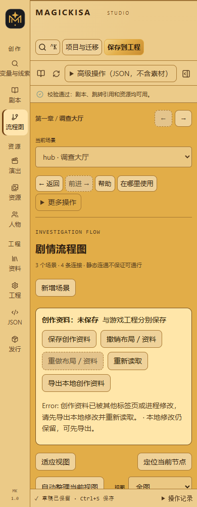

# 调查剧情与复杂流程工作台

适用版本：**2.0.0-dev.3**。面向单人侦探调查、非线性地点探索和剧本杀式文字叙事。保持现代工程 `schemaVersion: 2`、存档字段和稳定 ID；没有多人联网、主持人系统、玩家举证界面或路线重放。

## 画布与关系编辑

- 点击节点查看属性，双击或「前往完整剧本」编辑连续台词。
- 从「下一场景」出口拖到目标节点。替换已有目标会显示原、新目标，点击「应用连接」提交。
- 每个分支都有独立出口。「新增分支」出口拖线后先填写文案再提交；也可使用侧栏表单完成全部编辑。
- 点击连线或当前节点关系列表，编辑文案、目标、一次性、条件与效果。自环、回访和相同目标的多条关系不会合并。
- 删除下一场景只清除 `next`；删除分支须确认，其条件与效果一起移除。删除场景仍执行完整引用检查。
- 结构操作使用顶部撤销／重做，文字沿用失焦、切换字段或 800ms 间隔的归组规则。


全图、按章节和当前节点邻域可以切换。邻域支持一层／两层、入边／出边／双向；还可筛选条件连接和问题节点。跨范围连接单独列出，可展开目标，隐藏不会变成“不存在”。

提供平移、缩放、适应视图、定位当前、缩略地图和手动拖动。显式自动整理先收拢强连通分组，再用 Dagre 排列层级，在循环内部排列节点，避免回访形成巨大的布局层级。普通文字编辑和页面切换不会重排保存的坐标。

超过 300 个节点且没有既有偏好时，默认打开当前节点邻域；全图仍可显式选择。大型工程首次不强制缩到全图，配合可视区域裁剪减少同时绘制的关系。

拖动、自动整理只修改创作布局，使用独立的会话撤销／重做。关系列表支持搜索与键盘操作；手机将侧栏移至画布下方，无须拖线即可完成全部关系编辑。



## 条件与线索

在「资料」页定义线索，用现有 `unlockMaterial` / `markRead` 效果及解锁规则表达调查进度，不增加任务模型。

```json
{"type":"material","id":"key","state":"read","value":true}
```

`state` 为 `unlocked` 或 `read`；省略 `value` 等于 `true`，`false` 要求未达到该状态。读取现有存档集合，不自动改变它们。

```json
{"type":"contains","key":"suspects","value":{"id":"gardener","cleared":false}}
```

列表中存在该 JSON 值时成立。对象键顺序无关，数组顺序有关，数字与字符串不相等；非列表变量不满足。

```json
{
  "type":"all",
  "conditions":[
    {"type":"material","id":"key","state":"read"},
    {"type":"contains","key":"suspects","value":"gardener"},
    {"type":"not","condition":{"type":"visited","nodeId":"ending-innocent"}}
  ]
}
```

条件编辑器提供递归全部／任一／取反与可读摘要。空 `all` 恒真，空 `any` 恒假，校验会警告。CLI schema、引用追踪和删除保护认识资料条件。

旧工程无需迁移；**使用新增条件时须升级开发工具和发行运行时，旧引擎可能拒绝。** 不新增资料自动解锁的循环求解，不反复迭代到固定点。完成效果、分支效果、目标门槛继续遵循原运行顺序。

## 变量与测试状态

「变量与线索」汇总变量读取、写入和玩家输入位置；资料显示解锁门槛和使用位置。变量名称、预期类型与用途只是注释，**不会初始化变量，也不限制高级 JSON**。类型混用、只读未找到写入均为警告，动态或外部赋值可能合法。

具名测试预设包含场景、变量、访问节点、已用分支、已解锁与已读资料。JSON 字段输入后需点击该控件的应用按钮；无效引用或已读未解锁时禁止预览。

- **读取开始**：先装载测试状态，再执行正常进入效果、解锁和隐藏台词过滤。例如预设 `visits: 8`，进入效果加一后为 9。
- **场景完成后检查**：作者直接提供已执行完成效果的最终状态，不重复执行进入／完成效果，也不模拟此前所有台词。

点击「带此状态真实预览」。预设不写入真实玩家存档，也不产生工程撤销记录。


画布可使用测试预设或当前真实预览，逐条解释一次性限制、完成效果后的分支条件、分支效果后的目标进入条件。没有可用分支时才考虑下一场景。解释本身无副作用，不触发进入、自动解锁或保存；使用其他场景状态时标作假设分析。修改工程后真实预览解释标记待更新，需手动刷新。

**静态连通与单状态解释都不能证明所有条件下可通行。** 实际阅读、输入、演出和创作意图仍需真实预览。

## 保存与协作

| 数据 | 位置 | 保存规则 |
| --- | --- | --- |
| 游戏工程 | `project.json` | 原 revision、备份、草稿与保存流程 |
| 布局／变量说明／测试预设 | `authoring/studio.json` | 格式 1、独立 SHA256 revision，「保存创作资料」 |
| 缩放／筛选 | 浏览器工作区偏好 | localStorage，失败提示本会话仍可用 |
| Agent 结构稿／基线 | `authoring/` 原文件 | 原同步协议，不覆盖 Studio 创作资料 |

创作资料使用共享工程写锁。另一标签页写入后返回 409，保留本地输入，可先导出本地创作资料，再重新读取和合并。切换工程或关闭页面时提示未保存资料；与工程保存状态分别显示。

同时提交工程和创作资料的接口使用恢复日志协调写入。中断后下次共享写锁先恢复；旧 Agent 日志兼容，普通 Agent 同步不会回滚或覆盖 Studio 文件。备份携带已有创作文件和同步状态。

删除节点后保留布局记录，预设失效引用会提示，不擅自改写预设。工程包格式仍为 1，默认携带创作文件；旧包无该文件仍可用。创作资料不进入游戏发行产物，原始附件仍须显式 `--include-sources`。

## CLI 与 Agent

```sh
node scripts/magickisa.mjs schema project --json
node scripts/magickisa.mjs schema studio --json
node scripts/magickisa.mjs schema preset --json
node scripts/magickisa.mjs graph --workspace ID --json
node scripts/magickisa.mjs validate --workspace ID --json
node scripts/magickisa.mjs build --workspace ID --json
```

`graph` 保留 `nodes/edges/unreachable/note`，追加稳定连接 `key`、连接类型、跨章节标识、`cycles` 和可定位 `diagnostics`。闭合循环、所有出口有门槛、无出口且未标结局为警告，允许有意的调查停留；不存在目标或资料为阻塞错误。

Agent 继续按稳定 ID 三方同步。不要从变量说明猜测初始值，不把测试预设作为实际初始化，不直接改写 `studio.json` 或 `.sync-state.json` 绕过 revision。通过 Studio 修改后的逻辑由原有增量同步保护。
