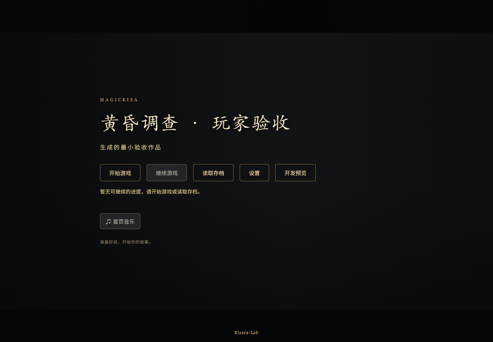
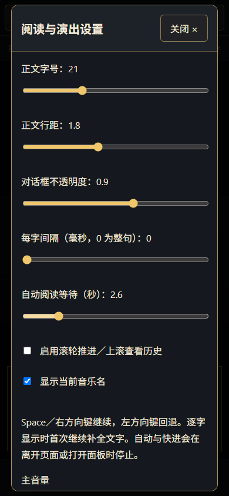
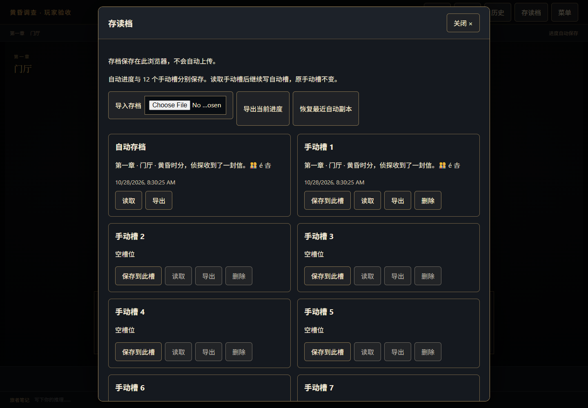

# 玩家阅读与存档指南

作者可选择显示锁定分支。开启时，暂不可选的文案标注“尚未满足选项条件”“目标暂不可进入”或“已选择（本周目仅一次）”；这些选项不可点击，也不会公开内部条件变量。默认仍隐藏不可用选项。一次性记录仅影响当前周目，重新开始可再次选择；已达成结局在收藏面板显示对应场景名。

音乐鉴赏与画廊一样跨周目保留已获得内容，读档、回退和重新开始不会收回已解锁曲目。面板显示已解锁数量，隐藏未解锁曲名；打开鉴赏暂停剧情音乐，关闭后从原位置续播。

资料、画廊和音乐的新内容通知按顺序显示；菜单、对话框、特殊演出或隐藏页面期间暂停显示与倒计时，回到阅读后可点“查看”定位。收藏使用独立格式 2，兼容读取旧格式 1，不改变玩家存档格式；存储失败提示仍需处理，内存收藏不代表已保存。

适用版本：**2.0.0-dev.5**。这是作品在浏览器中的玩家界面说明；编辑剧本、配置线索和编排 OP／ED 请参考 [Studio 调查手册](INVESTIGATION.md)。dev.5 使用存档格式 3，不自动转换旧开发版存档；请保留原版本与原数据。

每个手动槽在覆盖、导入和删除前会保留最近恢复副本，可从该槽卡片恢复或导出；副本写入失败会停止操作。损坏自动档的恢复页仅提供现有健康槽读取与导入，不把新空档当作“当前进度”保存。

收藏数据读取失败时，可重新读取或导出原数据；“备份并重建收藏”会先留存原始字节，再以本次收藏重建。旧损坏记录无法自动推断，备份失败不会覆盖。字号支持 16–40；故障配音允许自动阅读继续，仍可手动重试。关闭面板后方向键可继续；Tab 聚焦按钮时 Space 激活按钮，鼠标操作后 Space 推进阅读。

作品可以选择底部对话 ADV 或全屏阅读 NVL，并配置配音、主题和多轨演出。玩家字号等阅读偏好仍优先；等待点需要继续，允许跳过的演出提供跳过入口。音频受阻时可重试，菜单／失焦暂停期间不会继续演出时钟。

菜单中的“画廊与结局”展示已获得的收集内容，锁定条目隐藏标题与图片。记录按作品保留，重新开始故事不清空；保存失败会提示并允许重试／导出。Studio 预览的收集记录只保存在内存。

## 从标题页开始

- **开始游戏**：开始新周目；已有进度时先确认，并保留最近自动进度恢复副本。手动槽保持原样。
- **继续游戏**：恢复当前自动进度；显示场景和保存时间，没有可继续的进度时禁用。
- **读取存档**：打开自动槽和 12 个手动槽，也可以导入存档文件。
- **设置**：调整阅读效果、音量和音乐名显示。

玩家只需浏览器。作者部署的游戏与 Studio 的预览使用不同存储：Studio 预览完全在内存中，不读写真实玩家存档。

## 阅读和选择

点击画面或“继续”，也可以使用 Space／右方向键推进。左方向键回退；历史可以查看已读台词、搜索正文并选择回到某条记录。回退会截断之后的剧情历史，玩家笔记和已经取得的收藏保留。

默认整句显示。设置“每字间隔”大于 0 后启用逐字显示；第一次点击补全文字，下一次才推进。中文、组合字符和 emoji 以字素显示，不拆开表情。系统启用减少动态效果时直接整句显示。

- **自动**：完整显示台词后等待设定时间再推进，默认 2.6 秒，可调 1–10 秒。
- **快进**：仅推进已读台词，遇到未读、选择或玩家输入停止。
- 打开面板、切离页面或失焦会停止自动／快进，回来后需主动开启。
- 滚轮推进默认关闭；可在设置中启用，下滚继续，上滚打开历史。
- 输入姓名或笔记时保留正常键盘行为；中文输入法组合事件、长按和组合键不用于剧情推进。

界面分别提示等待输入、选择下一步、继续、结局或暂无可用出口。没有可用出口不一定是通关；可以检查资料、返回历史，必要时向作品作者报告。

## 菜单、设置和手机

顶部保留自动、快进、历史、存读档和菜单。菜单可进入资料、笔记、章节、音乐、设置、全屏和返回标题；手机同样能访问全部入口。

字号范围 16–32px，行距 1.4–2.4，对话框不透明度 0.75–1。阅读设置按作品单独保留在当前浏览器，不跟随存档文件或工程包。浏览器拒绝存储时，本次设置仍有效，同时提示没有保存。

面板可用 Esc 或关闭按钮退出，键盘焦点返回触发入口；确认对话框默认聚焦取消。浏览器不支持全屏时，可使用其自带菜单调整显示。

## 存读档

| 槽位             | 用法                                                           |
| ---------------- | -------------------------------------------------------------- |
| 自动存档         | 剧情操作后自动保存，继续游戏从这里恢复                         |
| 手动槽 1–12      | 点击保存建立当前状态的独立快照；之后继续游戏不会自动覆盖这些槽 |
| 最近自动恢复副本 | 读档、导入到自动槽或重新开始前保留一份；下次覆盖自动进度时替换 |

槽位卡片显示时间、章节、场景和当前台词摘要。手动保存不改变自动槽；读取手动槽后，恢复到自动槽继续，原手动槽仍然保留。

覆盖或删除手动槽需要确认。自动槽没有普通删除按钮；要从头开始请使用“开始游戏”或菜单中的“重新开始”。

### 导入和导出

1. 导入 JSON 文件，先检查作品、内容版本与存档位置。
2. 查看待导入摘要，选择目标槽并确认。
3. 导入到手动槽时不改变当前游玩；导入到自动槽时恢复该进度。
4. 不兼容或损坏的文件不写入槽位。不要修改版本号来绕过校验。

每个槽可单独导出，损坏的槽也允许导出原始数据；“导出当前进度”可在自动保存失败或临时周目中保留内存进度。

存档只在当前浏览器，不会上传云端；清理站点数据、换浏览器或换设备之前，请导出重要进度。工程包不包含玩家存档。

### 存储失败和损坏

空间不足时不能把提示误认为保存成功：当前内存进度仍可导出，原槽保留；自动保存失败会持续提示，并提供重试。覆盖自动进度前如果恢复副本也无法写入，会停止覆盖。

自动存档损坏时，恢复页提供导出原数据、临时周目、正常手动槽读取，以及“备份原存档并建立可保存新周目”。不要直接清空浏览器数据。每个坏槽单独显示错误，不会让正常手动槽消失。

恢复副本仅保留最近一份，不是无限历史；频繁覆盖前请手动导出重要存档。

## 多标签页保护

同一作品一次只允许一个标签页写进度。其他页面显示等待，不会拿旧内存覆盖已有存档。可以关闭原页面，或在菜单中“释放存档写权限”，再到新页面点击“重新接管”；接管会重新读取最新数据，不强行抢占活跃页面。

保护使用浏览器 Web Locks，需要支持该能力的现代浏览器，并在 HTTPS 或本机地址运行。无法获取安全写锁的环境可以明确选择临时游玩，离开前导出；此时不会写入真实自动槽。临时模式的存档槽也只在内存中。

## 查阅资料与笔记

资料列表支持搜索并标明未读。打开整个分类不会批量标记；选择单条资料、正文显示在可见区域后才将该条标为已读。某些作品可能以“已阅读资料”作为后续分支条件，因此建议实际打开线索阅读。

新资料提示可直接定位对应条目。资料、历史和设置关闭后返回原剧情位置。旅者自由笔记与剧情自动记下的笔记分开显示，不提供自动推理或证据组合。

## 给作者的兼容说明

- dev.5 工程与玩家存档使用 `schemaVersion: 3`；稳定内容 ID、条件与效果顺序保持。旧开发版存档不自动转换。
- 既有 `auto` 键继续读取，新增槽位 ID 为 `manual-01` 至 `manual-12`，不维护另一套槽位索引。
- 逐字进度与阅读设置属于界面状态，不进入剧情变量；完整台词推进后才按原运行时规则记录已读。
- 玩家设置和槽位服务独立于 Studio 草稿、布局与 Agent 同步。
- 使用 `npm run test:player` 执行生成工程的真实浏览器验收；还应在自己的作品中测试实际音频、图片、输入、分支和 OP／ED。
